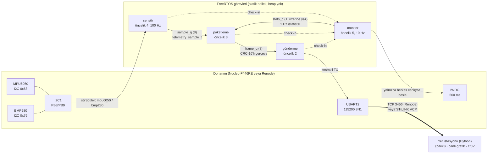

# embedded-telemetry

STM32F446RE + FreeRTOS üzerinde çalışan gömülü telemetri kartı firmware'i ve Python yer istasyonu.
IMU (MPU6050) ve basınç sensörü (BMP280) kendi yazdığım I2C sürücüleriyle 100 Hz okunur, basınçtan
irtifa hesaplanıp filtrelenir, veriler CRC-16'lı ikili paketlerle UART üzerinden yer istasyonuna gider.
Watchdog, sensör kopması algılama ve fail-safe mod vardır.

Kart gerekmez: proje **Renode** emülatöründe gerçek bir Nucleo-F446RE gibi çalışır, sensörler de
orada modellenir. Aynı ELF dosyası gerçek karta da yüklenebilir (pin haritası Nucleo ile aynı).


*Renode'da kaydedildi: 120 m'lik uçuş profili; 20. saniyede MPU6050 kopuyor (DEGRADED),
25. saniyede geri geliyor; 32. saniyede BMP280 kopuyor (FAILSAFE), 35. saniyede geri geliyor.
Yeniden üretmek için: [`tools/record_demo.py`](tools/record_demo.py).*

## İçindekiler
- [Mimari](#mimari)
- [Paket formatı](#paket-formatı)
- [Ölçümler](#ölçümler)
- [Hata yönetimi: watchdog ve fail-safe](#hata-yönetimi-watchdog-ve-fail-safe)
- [Derleme ve çalıştırma](#derleme-ve-çalıştırma)
- [Kalite kuralları](#kalite-kuralları)
- [Gerçek karta geçiş](#gerçek-karta-geçiş)
- [Dizin yapısı](#dizin-yapısı)

## Mimari



**Görevler ve öncelikler.** Öncelik sırası bilinçli: örnekleme deterministik olmalı, haberleşme
"best effort". CPU yetmezse en önce gönderme görevi aç kalır, kuyruk dolar ve atılan paket sayılır;
örnekleme periyodu bozulmaz.

| Görev | Öncelik | Periyot | İş |
|---|---|---|---|
| `monitor` | 5 (en yüksek) | 100 ms | Görev canlılığını denetler, IWDG'yi besler, LED ve fail-safe çıkışı, 1 Hz istatistik (CPU yükü, görev süreleri) |
| `sensor` | 4 | 10 ms (`xTaskDelayUntil`) | MPU6050 14 bayt + BMP280 6 bayt burst okuma, irtifa, alfa-beta filtre, sensör sağlığı, mod kararı |
| `packer` | 3 | olay güdümlü | Örnek ve istatistikleri çerçeveler, ortak `seq` sayacı |
| `tx` | 2 | olay güdümlü | Çerçeveyi kesmeli UART'a verir, bitene kadar task notification ile uyur |

**Katmanlar.** Donanımdan bağımsız kod (`firmware/core`, `firmware/drivers`) hem hedef hem bilgisayar
için derlenir; sürücüler donanıma doğrudan değil `i2c_bus_t` arayüzüne yazar. Böylece sürücü mantığı
bilgisayarda sahte bir I2C veri yoluyla test edilir.

```
firmware/
├── core/      crc16, packet (kodlayıcı + akış ayrıştırıcı), altitude, alt_filter, health, supervisor
├── drivers/   i2c_bus.h (arayüz), mpu6050, bmp280
├── bsp/       stm32f446: kayıt seviyesinde I2C1, USART2, TIM2, IWDG, startup, linker (HAL yok)
└── app/       FreeRTOSConfig.h, main.c ve dört görev
```

**İrtifa ve filtre.** İrtifa uluslararası standart atmosfer formülüyle hesaplanır
(`h = 44330 · (1 − (p/p0)^(1/5.255))`). `p0`, açılıştaki ilk 0,5 s'nin ortalama basıncıdır, yani irtifa
kalkış noktasına göredir. Gürültü bir **alfa-beta (g-h) filtresiyle** azaltılır: filtre konumla
birlikte dikey hızı da izlediği için sabit tırmanışta hareketli ortalamanın sabit gecikmesi oluşmaz.
Tek seferlik büyük sıçramalar artık (residual) sınırlanarak bastırılır. Testte 0,5 m RMS gürültü
en az 3 kat azalıyor, 5 m/s tırmanışta 10 s sonra hata 10 cm'nin altında.

## Paket formatı

Tüm alanlar **little-endian**. CRC, `ver` alanından payload sonuna kadar hesaplanır.
Ayrıntılı belge: [docs/packet_format.md](docs/packet_format.md).

| Ofset | Boyut | Alan | Açıklama |
|---:|---:|---|---|
| 0 | 1 | `sync0` | `0xA5` |
| 1 | 1 | `sync1` | `0x5A` |
| 2 | 1 | `ver` | Protokol sürümü (`0x01`) |
| 3 | 1 | `type` | `0x01` telemetri, `0x02` istatistik |
| 4 | 2 | `seq` | Ortak paket sayacı (u16, sarar): kayıp buradaki boşluklardan ölçülür |
| 6 | 1 | `len` | Payload uzunluğu |
| 7 | len | `payload` | Aşağıda |
| 7+len | 2 | `crc` | CRC-16/CCITT-FALSE (poly 0x1021, init 0xFFFF; `"123456789"` → `0x29B1`) |

**Telemetri (tip 0x01, 32 bayt, 100 Hz, çerçeve 41 bayt):**

| Ofset | Tip | Alan | Birim |
|---:|---|---|---|
| 0 | u32 | `t_ms` | açılıştan beri ms |
| 4 / 6 / 8 | i16 | `ax`, `ay`, `az` | mg |
| 10 / 12 / 14 | i16 | `gx`, `gy`, `gz` | 0,1 °/s |
| 16 | i16 | `temp` | 0,01 °C |
| 18 | u32 | `pressure` | Pa |
| 22 | i32 | `alt_raw` | cm, filtresiz |
| 26 | i32 | `alt_filt` | cm, filtreli |
| 30 | u8 | `mode` | 0 NORMAL, 1 DEGRADED, 2 FAILSAFE |
| 31 | u8 | `faults` | bit0 IMU, bit1 BARO, bit2 kuyruk taşması, bit3 watchdog reseti |

**İstatistik (tip 0x02, 18 bayt, 1 Hz):** `uptime_ms` u32, `cpu_load` u16 (‰), `sensor_max_us`,
`packer_max_us`, `tx_max_us`, `queue_drops`, `i2c_errors` (u16), `reset_cause` u8, `mode` u8.

100 Hz × 41 bayt ≈ 4,1 kB/s; 115200 baud (≈ 11,5 kB/s) hattın yaklaşık %36'sı.

Ayrıştırıcı (C'de `packet_parser_feed`, Python'da `FrameDecoder`) bayt bayt çalışır. Sahte bir
`A5 5A` dizisi sürüm baytında reddedilir, böylece arkasından gelen gerçek çerçeve yutulmaz.

## Ölçümler

Renode 1.15.3'te, CPU 16 MIPS'e (16 MHz HSI) ayarlıyken 48 s'lik demo uçuşundan
(`tools/record_demo.py`). Gerçek kartta [aşağıdaki](#gerçek-karta-geçiş) notlara bakın.

| Ölçüm | Değer | Nasıl ölçüldü |
|---|---|---|
| CPU yükü (NORMAL) | **%6,3 – %6,6** | FreeRTOS idle görev sayacı / TIM2 (1 MHz) |
| CPU yükü (bir sensör kopukken) | %5,2 – %5,6 | Arızalı sensör okunmaz, yalnızca saniyede bir yeniden denenir |
| Sensör görevi, döngü başına en uzun süre | **279 µs** (10 ms bütçenin %2,8'i) | TIM2 ile döngü başı/sonu, 1 s'lik pencerede maksimum |
| Paketleme görevi, en uzun | 346 µs | Aynı yöntem; üst öncelikli sensör görevinin araya girmesi dahil |
| Gönderme görevi, en uzun (CPU kısmı) | 79 µs | UART'ın baytları kesmeyle göndermesi beklenen süre hariç |
| Sensör yeniden bağlanma döngüsü | 10,5 ms (bir kez) | MPU6050 uyandırma beklemesi (10 ms); cihaz reseti (100 ms) bilerek atlanıyor |
| Paket kaybı | **0 / 4835** (%0,00) | Yer istasyonu, `seq` boşlukları |
| CRC hatası | 0 | Yer istasyonu |
| Kuyruk taşması | 0 | `queue_drops` (Renode testi de 0 olmasını şart koşuyor) |
| Sensör kopması → mod değişimi | 30 ms (3 ardışık hata) | `health` modülü, Unity ve Renode testleri |
| Sensör geri gelince → NORMAL | ≤ 1,5 s | En fazla 1 s yeniden deneme aralığı + 50 temiz okuma (0,5 s) |
| Flash / RAM | 16,0 KB / 11,3 KB | `arm-none-eabi-size` (MinSizeRel); RAM'in çoğu statik görev yığınları |

> Renode komut düzeyinde emüle eder, çevrim doğru (cycle-accurate) değildir. Bu yüzden CPU yükü ve
> µs değerleri gerçek karttakinin yaklaşığıdır; göreceli karşılaştırma (örneğin hangi görev ne kadar
> sürüyor, arıza modunda yük nasıl değişiyor) için güvenilirdir.

Paket kaybı hesabı yer istasyonu tarafında da test edilir: simülatör (`telemetry_gs.simulate`)
kasıtlı kayıp, bozulma ve çöp bayt ekler; 60 s'lik bir koşuda %0,5 kayıp + %0,3 bozulma ile çözücü
6004 çerçeve aldı, 56 kayıp (%0,92, CRC'si bozuk olanlar da kayıp sayılır) ve 18 CRC hatası raporladı.

## Hata yönetimi: watchdog ve fail-safe

**Sensör sağlığı** (`firmware/core/src/health.c`):
- Üst üste 3 başarısız okuma (30 ms) → sensör arızalı. Tek tük hatalar arıza sayılmaz.
- Arızalı sensör artık her döngü okunmaz (kopuk cihaza her 10 ms'de zaman aşımı beklemek döngüyü
  bozar), saniyede bir yeniden yapılandırma denenir.
- Üst üste 50 temiz okuma (0,5 s) → iyileşti. Arada tek hata sayacı sıfırlar.

**Mod politikası:**

| Durum | Mod | Davranış |
|---|---|---|
| Her şey yolunda | NORMAL | LED 1 Hz yanıp söner |
| Yalnızca IMU yok | DEGRADED | IMU alanları 0 gönderilir, irtifa geçerli; LED 2,5 Hz |
| Basınç sensörü yok (tek başına veya ikisi birden) | FAILSAFE | İrtifa son geçerli değerde donar, filtre sıfırlanır (eski hızla boşluğu köprülemesin diye); PA6 fail-safe çıkışı aktif; LED 5 Hz |

İrtifa bu kartın birincil çıktısı olduğu için basınç sensörü kaybı FAILSAFE sayılır.

**Watchdog** (`firmware/core/src/supervisor.c`): IWDG'yi yalnızca en yüksek öncelikli `monitor`
görevi besler, o da **ancak diğer üç görev kendi son tarihleri içinde check-in yaptıysa**. Takılan
bir görev olursa watchdog beslenmez ve ~500 ms içinde MCU resetlenir. Açılışta `RCC_CSR`'den reset
nedeni okunur; watchdog reseti `faults` bit3 ve istatistik paketindeki `reset_cause = 1` ile yer
istasyonuna bildirilir. `configASSERT`, yığın taşması kancası ve beklenmeyen kesmeler de fail-safe
çıkışını açıp watchdog'un resetlemesini bekler.

Renode'da doğrulandı: CPU 1 s durdurulunca IWDG reset atıyor, sonraki istatistik paketinde
`reset_cause=1`, telemetride `faults=0x0c` görülüyor. Renode'un kendi RCC modeli reset bayraklarını
tutmadığı için `renode/models/STM32F4_ResetFlags.cs` ile düzeltilmiş bir kopya kullanılıyor.

## Derleme ve çalıştırma

Gereksinimler: CMake ≥ 3.20, `gcc`, `gcc-arm-none-eabi` + `libnewlib-arm-none-eabi`, Python ≥ 3.10,
Renode 1.15.3. FreeRTOS-Kernel (V11.1.0) ve Unity (v2.6.0) CMake tarafından indirilir.

```bash
# 1) Birim testleri (bilgisayarda, ASan + UBSan açık)
cmake -S . -B build/host && cmake --build build/host -j && ctest --test-dir build/host

# 2) Firmware
cmake -S . -B build/fw -DCMAKE_TOOLCHAIN_FILE=cmake/arm-none-eabi.cmake -DCMAKE_BUILD_TYPE=MinSizeRel
cmake --build build/fw -j          # build/fw/firmware/firmware.{elf,bin}

# 3) Renode'da çalıştır (USART2 -> TCP 3456)
renode --disable-gui --console renode/telemetry.resc -e start

# 4) Yer istasyonu (başka bir terminalde)
pip install -e ground_station
python -m telemetry_gs --tcp localhost:3456 --csv ucus.csv

# 5) Uçtan uca Renode testleri
renode-test -r renode/tests/results renode/tests/telemetry.robot
```

Renode monitöründe arıza enjeksiyonu: `sysbus.i2c1.mpu6050 Disconnected true` (veya `bmp280`).
Ayrıntılar: [renode/README.md](renode/README.md), [ground_station/README.md](ground_station/README.md).

**CI** (GitHub Actions): host birim testleri + kapsama özeti, `-Werror` ile firmware derlemesi,
firmware ELF'inin Renode'da otomatik test edilmesi, yer istasyonu için pytest + `mypy --strict`.

## Kalite kuralları

- **C11**, `-Wall -Wextra -Werror -pedantic -Wconversion -Wsign-conversion -Wshadow -Wcast-qual
  -Wdouble-promotion -Wstrict-prototypes ...` (proje kodunun tamamında).
- **Dinamik bellek yok** (MISRA C:2012 Kural 21.3): FreeRTOS `configSUPPORT_DYNAMIC_ALLOCATION 0`,
  tüm görev/kuyruk nesneleri statik; `malloc/calloc/realloc/free` her kaynak dosyada
  `#pragma GCC poison` ile derleme hatası; derleme sonrası ELF'te ayırıcı sembolü olmadığı
  doğrulanıyor (`cmake/check_no_heap.cmake`).
- MISRA'ya yakın stil: tek çıkışlı `switch` dalları, açık `U` son ekleri ve tür dönüşümleri,
  `else` dalı olmayan `if/else if` zinciri yok, işaretli sayılarda sola kaydırma yok (UBSan
  Bosch referans kodundaki bu tanımsız davranışı yakaladı, çarpma ile yazıldı).
- **Testler:** Unity ile 8 test grubu (CRC, paketleme/ayrıştırıcı, irtifa, filtre, sağlık,
  denetleyici, MPU6050 ve BMP280 sürücüleri sahte I2C yoluyla). BMP280 kompanzasyonu Bosch'un
  64-bit referans sonucuyla bit düzeyinde aynı. Host testleri AddressSanitizer + UBSan ile koşar.
- Renode testleri iki gerçek hata yakaladı: açılışta sensör görevinin kaçırdığı periyotları art
  arda çalıştırıp kuyruğu taşırması ve sensör yeniden bağlanırken 100 ms'lik reset beklemesinin
  örneklemeyi durdurması. İkisi de düzeltildi ve testle korunuyor.

## Gerçek karta geçiş

Aynı `firmware.elf` Nucleo-F446RE'ye yüklenebilir (`st-flash write build/fw/firmware/firmware.bin 0x08000000`
veya STM32CubeProgrammer). Bağlantılar:

| Sensör pini | Nucleo |
|---|---|
| VCC | 3V3 |
| GND | GND |
| SCL (her iki sensör) | D15 / PB8 |
| SDA (her iki sensör) | D14 / PB9 |
| BMP280 SDO | GND (adres 0x76) |
| MPU6050 AD0 | GND (adres 0x68) |

Telemetri ST-LINK sanal COM portundan gelir: `python -m telemetry_gs --serial /dev/ttyACM0`.
Notlar: sensör kartlarında pull-up direnci yoksa SDA/SCL'ye 4,7 kΩ ekleyin (dahili pull-up'lar
400 kHz için zayıf). Saat bilerek 16 MHz HSI'da bırakıldı (PLL yok), böylece Renode ve kart aynı
zamanlamayla çalışıyor.

## Dizin yapısı

```
├── firmware/         C11 firmware (core, drivers, bsp, app)
├── tests/            Unity birim testleri + sahte I2C veri yolu
├── renode/           platform, C# sensör modelleri, Robot testleri
├── ground_station/   Python yer istasyonu (telemetry_gs)
├── tools/            record_demo.py (Renode demo kaydı + CSV)
├── docs/             paket formatı, Renode sözleşmesi, görseller
└── cmake/            arm-none-eabi toolchain, heap kontrolü
```
