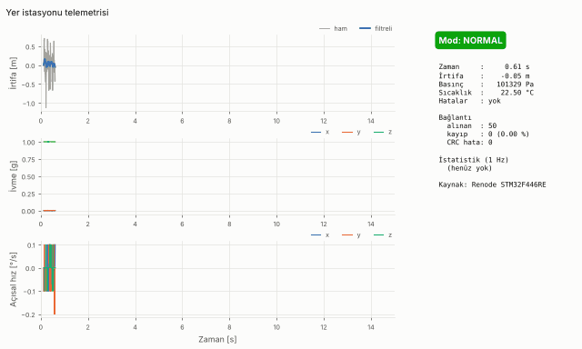

# Yer istasyonu (`telemetry_gs`)

STM32F446RE telemetri kartından (gerçek kart veya Renode) gelen ikili çerçeveleri
çözen, CSV'ye kaydeden, canlı grafik çizen ve bağlantı kalitesini (kayıp paket,
CRC hatası) raporlayan Python yer istasyonu.

Çerçeve formatı: [`../docs/packet_format.md`](../docs/packet_format.md)
(senkron `0xA5 0x5A`, CRC-16/CCITT-FALSE, little-endian; tip `0x01` telemetri
100 Hz, tip `0x02` istatistik 1 Hz).



## Kurulum

Python 3.10+ gerekir.

```bash
cd ground_station
pip install -r requirements.txt      # veya: pip install -e .  (komutlar da kurulur)
```

`pip install -e .` ile şu komutlar da gelir: `telemetry-gs`, `telemetry-gs-sim`,
`telemetry-gs-gif` (aşağıdaki `python -m ...` çağrılarıyla aynıdır).

## Kullanım

Kaynaklardan **biri** zorunludur: `--serial`, `--tcp` veya `--replay`.

```bash
# Gerçek kart (Nucleo ST-LINK sanal COM portu)
python -m telemetry_gs --serial /dev/ttyACM0 --baud 115200 --csv ucus.csv

# Renode: UART2 bir sunucu soket terminaline bağlıysa
#   (emulation CreateServerSocketTerminal 3456 "term" false; connector Connect sysbus.usart2 term)
python -m telemetry_gs --tcp localhost:3456 --csv renode.csv --raw-out renode.bin

# Kaydedilmiş ham baytları tekrar oynat (grafiksiz, en yüksek hızda)
python -m telemetry_gs --replay renode.bin --no-plot --csv renode.csv --stats-csv renode_stats.csv
```

| Seçenek | Açıklama |
|---|---|
| `--serial PORT` | Seri port (`/dev/ttyACM0`, `COM3` …) |
| `--baud N` | Seri port hızı, varsayılan `115200` |
| `--tcp HOST:PORT` | TCP istemcisi (Renode soket terminali). Bağlantı `--connect-timeout` (varsayılan 10 s) boyunca yeniden denenir, böylece istasyon emülatörden önce başlatılabilir |
| `--replay DOSYA` | Ham ikili kaydı oynat |
| `--replay-rate B/s` | Oynatma hızı (bayt/s). `0` = sınırsız. Varsayılan: grafikle 4127 (≈ gerçek zaman), `--no-plot` ile sınırsız |
| `--csv DOSYA` | Telemetri CSV'si |
| `--stats-csv DOSYA` | İstatistik (1 Hz) CSV'si |
| `--raw-out DOSYA` | Alınan tüm ham baytları kaydet (sonra `--replay` ile oynatılabilir) |
| `--no-plot` | Grafik penceresi açma; saniyede bir durum satırı yazdırır (`--quiet` ile kapatılır) |
| `--duration S` | S saniye sonra dur |
| `--window S` | Grafikte gösterilen zaman penceresi (varsayılan 10 s) |

Çıkışta (süre doldu, kaynak bitti, pencere kapandı veya Ctrl+C) stderr'e bir özet
yazılır:

```
=== Bağlantı özeti ===
Kaynak       : tcp:localhost:3456
Süre         : 60.2 s, 247820 bayt
Çerçeve      : 6004 (telemetri 5945, istatistik 59, bilinmeyen tip 0)
Alınan       : 6004  Kayıp: 56  Kayıp oranı: 0.92 %
CRC hatası   : 18  Uzunluk hatası: 1  Sürüm hatası: 1  Atılan bayt: 969
Yinelenen seq: 0  Sayaç sıçraması (reset?): 0
```

Ekranı olmayan bir makinede (etkileşimli matplotlib arka ucu yoksa) grafik
istenirse uyarı verilir ve otomatik olarak `--no-plot` moduna geçilir.

### Canlı grafik

- İrtifa: ham (gri) ve filtreli (mavi), metre
- İvme x/y/z (g) ve açısal hız x/y/z (°/s)
- Durum paneli: mod (NORMAL / DEGRADED / FAILSAFE renkli rozet), hata bitleri,
  alınan/kayıp paket ve kayıp yüzdesi, CRC hataları, CPU yükü, görevlerin en uzun
  çalışma süreleri (sensör/paketleme/gönderme), kuyruk atmaları, I2C hataları,
  reset nedeni

### Kayıp ve hata sayımı nasıl yapılır?

- `seq`, tüm çerçeve tipleri için **ortak** u16 sayaçtır. Ardışık iki geçerli
  çerçeve arasındaki fark `d` (mod 65536) ise `d - 1` çerçeve kayıp sayılır;
  65535 → 0 sarması doğru işlenir.
- CRC'si bozuk çerçeve atlanır ve `CRC hatası` olarak sayılır; seq'i hiç
  alınmadığı için ayrıca **kayıp** olarak da görünür.
- Çözücü, bozuk başlık/uzunluk/CRC durumunda yalnızca 1 bayt ilerleyip yeniden
  senkron arar; çöp baytlar veya sahte `A5 5A` dizileri gerçek bir çerçevenin
  kaçırılmasına yol açmaz.
- Aynı seq tekrar gelirse "yinelenen", 32768'den büyük ileri sıçrama (ör. kart
  resetlenip sayaç 0'dan başladıysa) "sayaç sıçraması" sayılır, kayba eklenmez.
- Kayıp oranı = kayıp / (alınan + kayıp) × 100.

## CSV formatı

Sütun adları birimleri içerir; değerler kablo formatının tam hassasiyetiyle
yazılır (geri okununca ham değerler birebir elde edilir).

Telemetri: `host_time_s, seq, t_s, ax_g, ay_g, az_g, gx_dps, gy_dps, gz_dps,
temp_c, pressure_pa, alt_raw_m, alt_filt_m, mode, mode_name, faults, rx_total,
lost_total, crc_errors_total`

İstatistik: `host_time_s, seq, uptime_s, cpu_load_pct, sensor_max_us,
packer_max_us, tx_max_us, queue_drops, i2c_errors, reset_cause, mode, mode_name`

`host_time_s` istasyon başladığından beri geçen süredir; `rx_total / lost_total /
crc_errors_total` o satır çözüldüğü andaki birikimli sayaçlardır.

## Simülatör (firmware olmadan gösterim)

Uçuş profili: rampada bekleme → 2 s itki (~4 g) → süzülme → tepe noktası
(~230 m) → sürüklenme paraşütü (~12 m/s) → 150 m'de ana paraşüt (~5 m/s) → iniş.
Barometre gürültüsü, alfa-beta irtifa filtresi, IMU gürültüsü/titreşimi ve 1 Hz
istatistik çerçeveleri üretilir.

```bash
# Dosyaya yaz, sonra tekrar oynat
python -m telemetry_gs.simulate --out sim.bin --duration 60 --loss 0.01 --corrupt 0.003 --garbage 0.003 --fault-at 42
python -m telemetry_gs --replay sim.bin

# TCP sunucusu olarak gerçek zamanlı yayın (Renode yerine)
python -m telemetry_gs.simulate --tcp-server 3456 --loop
python -m telemetry_gs --tcp localhost:3456
```

| Seçenek | Açıklama |
|---|---|
| `--out DOSYA` / `--tcp-server [HOST:]PORT` | Çıkış: dosya veya TCP sunucusu (biri zorunlu) |
| `--duration S` | Uçuş süresi (varsayılan 60) |
| `--loss P` | Çerçeve kaybı olasılığı (seq yine artar) |
| `--corrupt P` | Bir bitin bozulma olasılığı (CRC hatası) |
| `--garbage P` | Çerçeveler arasına 1–24 çöp bayt ekleme olasılığı |
| `--fault-at S` | S. saniyede sensör arızası: 0,3 s DEGRADED, ardından FAILSAFE |
| `--fault-sensor imu\|baro` | Arızalanan sensör (varsayılan `imu`) |
| `--speed X` | TCP yayın hızı çarpanı (varsayılan 1.0) |
| `--loop` | TCP modunda uçuşu tekrarla, yeni istemcileri kabul et |
| `--seed N` | Rastgele tohum (tekrarlanabilir çıktı) |

## Gösterim GIF'i

CSV'den ekran gerektirmeden (Agg) GIF üretir. Tüm kayıt `--seconds` süresine
sıkıştırılır.

```bash
python -m telemetry_gs.simulate --out sim.bin --duration 60 --loss 0.005 --corrupt 0.003 --garbage 0.003 --fault-at 42
python -m telemetry_gs --replay sim.bin --no-plot --csv sim.csv --stats-csv sim_stats.csv
python -m telemetry_gs.make_gif sim.csv --stats-csv sim_stats.csv -o docs/demo_sim.gif --label simülatör
```

Varsayılanlar: 10 s, 10 fps, 72 dpi (720×432 piksel) → yaklaşık 2,2 MB.
Daha küçük dosya için `--dpi 60` veya `--fps 8` kullanılabilir.

## Testler

```bash
cd ground_station
python -m pytest -q
```

Kapsam: CRC kontrol değeri, kodlama/çözme gidiş-dönüş, her bayt sınırında
bölünmüş giriş, çerçeveler arası çöp, bozuk CRC (sayılır, atlanır, yeniden
senkron), seq boşlukları ve sarma ile kayıp sayımı, CSV çıktısı, TCP kaynağı,
komut satırı ve başsız grafik güncellemesi.

## Dosyalar

| Dosya | İçerik |
|---|---|
| `telemetry_gs/crc16.py` | Tablo tabanlı CRC-16/CCITT-FALSE |
| `telemetry_gs/protocol.py` | `Telemetry` / `Stats` veri sınıfları, `encode_frame()`, akış çözücü `FrameDecoder`, `SeqTracker` |
| `telemetry_gs/sources.py` | Seri port, TCP istemcisi, dosya oynatma kaynakları |
| `telemetry_gs/station.py` | Kaynak → çözücü → CSV/ham kayıt → grafik geçmişi |
| `telemetry_gs/csv_logger.py` | CSV yazma/okuma |
| `telemetry_gs/plot.py` | Gösterge paneli ve canlı grafik (FuncAnimation) |
| `telemetry_gs/simulate.py` | Uçuş simülatörü (dosya / TCP sunucusu) |
| `telemetry_gs/make_gif.py` | CSV'den GIF üretimi |
| `telemetry_gs/__main__.py` | Komut satırı arayüzü |
